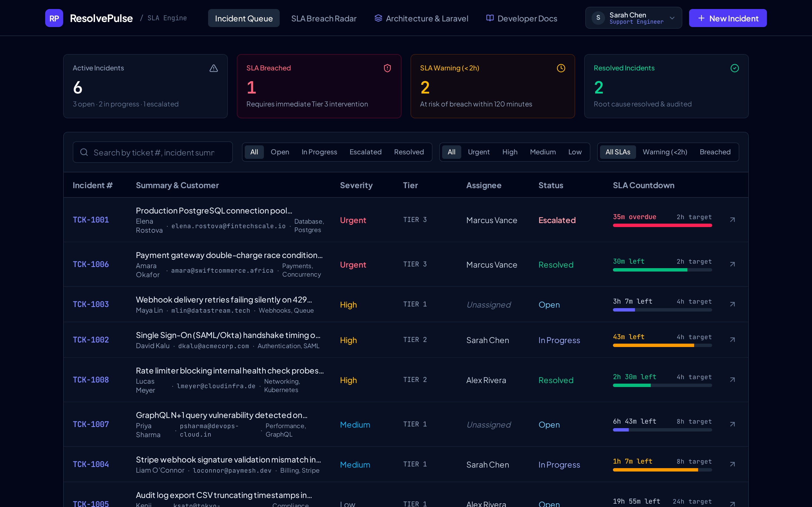
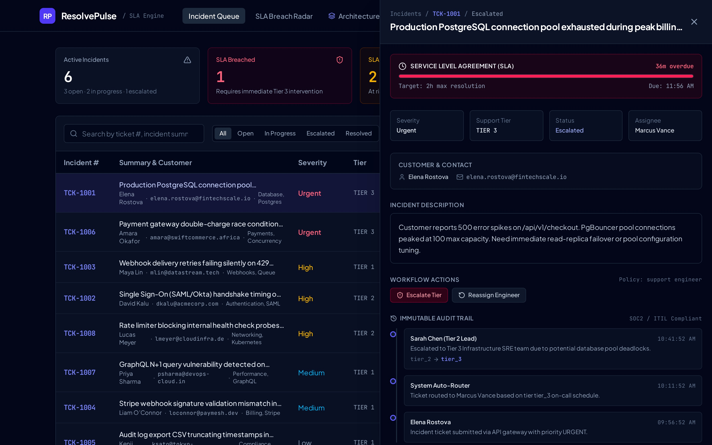

# ResolvePulse: Complete Project Documentation & Installation Guide

An enterprise-grade **Support Ticket & SLA Escalation Platform** built with **Clean Architecture**, the **Single Responsibility Principle (SRP)**, and **Multi-Tier Role-Based Access Control (RBAC)**.

---

## 📸 1. Visual Walkthrough & Screenshots

### 🖥️ Main Incident Operations Dashboard


**Key Interface Features:**
1. **Persona & Role Switcher** (Top Right): Instant switching between **Customer**, **Support Engineer**, and **Lead Admin** to verify permissions and policy boundaries in real time.
2. **SLA Health Metric Strip**: High-contrast KPI telemetry showing active incidents, critical SLA breaches (Crimson), SLA warning radar (Amber), and resolution velocity (Emerald).
3. **High-Density Incident Queue**: Sortable, filterable incident data grid featuring real-time tabular countdowns (`35m overdue`, `30m left`), color-coded progress bars, severity tiers (`Urgent`, `High`, `Medium`, `Low`), and assigned engineers (`Marcus Vance`, `Sarah Chen`).
4. **Instant Search & Filter Bar**: Filter by status, severity, or search by ticket ID (`TCK-1001`) or incident summary.

---

### 🔍 Incident Triage, Escalation & SOC2 Audit Drawer


**Key Drawer Features:**
1. **Lifecycle Transition Dropdown**: Guarded status workflow (`Open` $\rightarrow$ `In Progress` $\rightarrow$ `Escalated` $\rightarrow$ `Resolved` $\rightarrow$ `Closed`).
2. **Escalation Reason & Tier Banner**: Highlights active escalation tier (Tier 1 Support, Tier 2 Engineering, or Tier 3 SRE Core) with requirement for documented rationale.
3. **Internal Investigation Notes**: Engineers can log threaded notes without modifying customer-visible ticket descriptions.
4. **Immutable SOC2/ITIL Audit Trail**: Every status change, assignment, note, and escalation creates a cryptographically timestamped event with author attribution.

---

## 🏛️ 2. Clean Architecture & System Philosophy

ResolvePulse strictly isolates business rules from HTTP frameworks, transport layers, and persistence mechanisms:

```
┌─────────────────────────────────────────────────────────────────┐
│                    React 19 Frontend (SPA)                     │
│           (State, Tabular UI, SLA Timers, Auth Context)         │
└────────────────────────────────┬────────────────────────────────┘
                                 │ HTTP / JSON API (Bearer Token)
                                 ▼
┌─────────────────────────────────────────────────────────────────┐
│                   Layer 1: FormRequest Validation               │
│      - Laravel: app/Http/Requests/StoreTicketRequest.php        │
│      - Express: server/requests/TicketRequests.ts               │
│      • Validates lengths, required fields, enum boundaries      │
│      • Returns RFC 7807 / Laravel 422 Unprocessable Entity      │
└────────────────────────────────┬────────────────────────────────┘
                                 │ Valid DTO Payload
                                 ▼
┌─────────────────────────────────────────────────────────────────┐
│                   Layer 2: Presentation Controller              │
│      - Laravel: app/Http/Controllers/Api/TicketController.php   │
│      - Express: server/controllers/TicketController.ts          │
│      • Dispatches DTO to Service, serializes response to JSON   │
│      • ZERO business logic, ZERO database queries               │
└────────────────────────────────┬────────────────────────────────┘
                                 │
                                 ▼
┌─────────────────────────────────────────────────────────────────┐
│                   Layer 3: Domain Service Layer                 │
│      - Laravel: app/Services/TicketService.php                  │
│      - Express: server/services/TicketService.ts                │
│      • SlaEvaluationService calculates deadlines and warnings   │
│      • State machine invariant rules (e.g. unassigned tickets)  │
│      • Authorization Policies: Can user escalate to Tier 3?     │
│      • Dispatches immutable audit logs                          │
└────────────────────────────────┬────────────────────────────────┘
                                 │
                                 ▼
┌─────────────────────────────────────────────────────────────────┐
│              Layer 4: Repository Contract (Inversion of Control)│
│      - Laravel: app/Repositories/Contracts/TicketRepository... │
│      - Express: server/contracts/ITicketRepository.ts           │
│      • Implementation: EloquentTicketRepository (SQLite/MySQL)  │
└─────────────────────────────────────────────────────────────────┘
```

---

## 👥 3. How to Use: Persona Roles & Permissions

ResolvePulse ships with 3 pre-seeded personas for end-to-end testing:

| Persona | Email | Password | Role | Permissions |
| :--- | :--- | :--- | :--- | :--- |
| **Elena Rostova** | `elena.rostova@fintechscale.io` | `password123` | **Customer** | • Submit new incident tickets.<br>• View own company tickets.<br>• Restricted from resolving, closing, or escalating (`403 Forbidden`). |
| **Sarah Chen** | `sarah.c@resolvepulse.internal` | `password123` | **Support Engineer** | • Triage and claim tickets.<br>• Add internal investigation notes.<br>• Escalate to Tier 1 and Tier 2.<br>• Resolve tickets with resolution summary.<br>• Cannot close tickets or authorize Tier 3 emergency escalations. |
| **Marcus Vance** | `marcus.v@resolvepulse.internal` | `password123` | **Lead Admin** | • Full governance and system oversight.<br>• Authorize Tier 3 SRE Core escalations.<br>• Inspect all internal SOC2 audit trails.<br>• Mark resolved tickets as Closed. |

### How to Switch Personas in the UI:
1. Click the **User Badge** in the top-right corner of the application header.
2. Select any persona from the dropdown menu (e.g., switch to **Elena Rostova** to test Customer boundaries).
3. The JWT token in `localStorage` updates automatically and the queue adapts dynamically to role policies.

---

## ⚙️ 4. Local Installation Guide (Step-by-Step)

You can run this full project locally on your machine with **PHP Laravel 11** serving the API and **React 19** serving the user interface.

### 📋 Prerequisites
Ensure your computer has the following installed:
1. **PHP 8.2 or 8.3** (`php -v`)
   - *Windows*: Download from [windows.php.net](https://windows.php.net/download/) or use [Laravel Herd](https://herd.laravel.com/) / [Laragon](https://laragon.org/).
   - *macOS*: Install via Homebrew: `brew install php` or use [Laravel Herd](https://herd.laravel.com/).
   - *Linux (Ubuntu/Debian)*: `sudo apt install php8.2 php8.2-sqlite3 php8.2-curl php8.2-mbstring php8.2-xml`
2. **Composer** (`composer -v`) — [getcomposer.org](https://getcomposer.org/download/)
3. **Node.js 18+ and npm** (`node -v` and `npm -v`) — [nodejs.org](https://nodejs.org/)

---

### Step A: Export or Extract the Project

If using the web applet:
1. Open the **"Architecture & Laravel"** tab.
2. Click **"Export Laravel (.ZIP)"** to download the backend.
3. Organize your local workspace:
   ```
   my-project/
   ├── backend/    <-- contents of laravel-backend/
   └── frontend/   <-- contents of root folder (src, package.json, vite.config.ts)
   ```

---

### Step B: Setup and Run the Laravel Backend

Open a terminal inside your `backend/` folder:

```bash
cd backend

# 1. Install PHP dependencies
composer install

# 2. Copy the environment template
cp .env.example .env

# 3. Generate Laravel encryption key
php artisan key:generate

# 4. Create SQLite database, build tables, and seed initial data (All-in-one command)
php artisan migrate --seed
```

> 💡 **Notice on SQLite:** You do **NOT** need to install, start, or configure a database server! When prompted:  
> `The SQLite database does not exist: database/database.sqlite. Would you like to create it? (yes/no) [yes]:`  
> Simply press **Enter**. Laravel will create the file and seed all tables and test accounts automatically.

```bash
# 5. Start the Laravel development server
php artisan serve
```

Your Laravel backend API is now running at:  
👉 **`http://127.0.0.1:8000`**

---

### Step C: Setup and Run the React Frontend

Open a second terminal window inside your `frontend/` folder:

```bash
cd frontend

# 1. Configure the API endpoint to point to your local Laravel server
echo VITE_API_URL=http://127.0.0.1:8000 > .env.local

# 2. Install Node.js packages
npm install

# 3. Start the Vite React development server
npm run dev
```

Your React frontend is now running at:  
👉 **`http://localhost:3000`** (or `http://localhost:5173`)

Open the browser URL, log in with any test persona, and start managing incidents against your local Laravel backend!

---

## 🗂️ 5. Comprehensive Directory & File Map

### 🟢 React Frontend (`src/`)

| File Path | Architecture Role | Description |
| :--- | :--- | :--- |
| `src/main.tsx` | **Root Mount** | Mounts React tree to DOM element `#root`. |
| `src/App.tsx` | **Application Controller**| Root state: active tab, auth context, incident polling, filter state, and modal toggles. |
| `src/types/ticket.ts` | **Client Contracts** | TypeScript interfaces for `Ticket`, `User`, `TicketAuditLog`, and `DashboardMetrics`. |
| `src/api/authClient.ts` | **Auth Service Client** | Manages login, registration, JWT tokens, and persona switching. |
| `src/api/ticketClient.ts` | **Ticket Service Client** | REST client for tickets, status updates, escalation payloads, and JSZip export generator. |
| `src/components/TopBar.tsx` | **Navigation Header** | Single wordmark, tab navigation, user persona selector, and `+ New Incident` CTA. |
| `src/components/SlaMetricStrip.tsx`| **KPI Telemetry** | High-contrast KPI cards: Active, SLA Breached, SLA Warning, and Resolved metrics. |
| `src/components/TicketQueueTable.tsx` | **Incident Grid** | Tabular density grid with real-time countdowns, status badges, and column sorting. |
| `src/components/TicketDetailDrawer.tsx`| **Action Slide-Over** | Lifecycle transitions, investigation notes, escalation modals, and SOC2 audit history. |
| `src/components/CreateTicketModal.tsx` | **Ingestion Modal** | Incident submission form with inline FormRequest 422 validation rendering. |
| `src/components/SlaBreachRadar.tsx` | **SLA Radar View** | Focused view prioritizing tickets within 2 hours of SLA violation. |
| `src/components/ArchitectureExplorer.tsx`| **Architecture Viewer** | Visual representation of Clean Architecture layers with live PHP/TypeScript code diffs. |

---

### 🔵 Laravel 11 Backend (`laravel-backend/`)

| File Path | Layer | Responsibility |
| :--- | :--- | :--- |
| `app/Models/Ticket.php` | **ORM Entity** | Eloquent model with casts (`tags` => `array`, `sla_due_at` => `datetime`). |
| `app/Models/TicketAuditLog.php` | **ORM Entity** | Eloquent model storing immutable system audit trails. |
| `app/Http/Controllers/Api/TicketController.php` | **Presentation** | Orchestrates requests via `TicketService` with zero SQL queries. |
| `app/Http/Controllers/Api/AuthController.php` | **Presentation** | Handles login, registration, token generation, and user info endpoints. |
| `app/Http/Requests/StoreTicketRequest.php` | **Validation** | Enforces title length, valid priorities, and valid email syntax. |
| `app/Http/Requests/UpdateTicketStatusRequest.php` | **Validation** | Validates status enum transitions and resolution descriptions. |
| `app/Http/Requests/EscalateTicketRequest.php` | **Validation** | Requires a minimum 10-character documented escalation justification. |
| `app/Http/Requests/AssignTicketRequest.php` | **Validation** | Validates assignee payload and updates state to in-progress. |
| `app/Services/TicketService.php` | **Domain Service** | State machine enforcement, ticket lifecycle coordination, and audit events. |
| `app/Services/SlaEvaluationService.php` | **Domain Service** | Pure mathematical calculations for SLA deadlines, warnings, and breach states. |
| `app/Repositories/Contracts/TicketRepositoryInterface.php` | **Repository Contract** | Pure PHP interface for data persistence inversion. |
| `app/Repositories/Eloquent/EloquentTicketRepository.php` | **Data Access** | Eloquent implementation executing SQLite/MySQL queries. |
| `app/Policies/TicketPolicy.php` | **Authorization** | Enforces role policies: customers cannot escalate, Tier 3 requires Lead Admin. |
| `database/migrations/*` | **Schema Definition** | Migrations for `users`, `tickets`, and `ticket_audit_logs`. |
| `database/seeders/*` | **Database Seeders** | Seeds initial enterprise tickets and default persona credentials. |
| `routes/api.php` | **Routing** | Clean RESTful route definitions for `/api/v1/auth` and `/api/v1/tickets`. |

---

## 🛠️ 6. Developer Modification Playbook

### Scenario A: Adding a New Field (e.g., `root_cause_analysis`)
1. **Domain Model**:
   - Add `root_cause_analysis: string | null` to `server/domain/Ticket.ts`.
   - Add `'root_cause_analysis'` to `$fillable` array in `laravel-backend/app/Models/Ticket.php`.
2. **Validation Layer**:
   - In `laravel-backend/app/Http/Requests/StoreTicketRequest.php`, add:
     ```php
     'root_cause_analysis' => 'nullable|string|max:1000',
     ```
3. **Database Migration**:
   - In `laravel-backend/database/migrations/*_create_tickets_table.php`, add:
     ```php
     $table->text('root_cause_analysis')->nullable();
     ```
4. **Service Layer**:
   - Update `CreateTicketDTO` and assign field in `TicketService.php`.
5. **UI Component**:
   - Add the input field in `src/components/CreateTicketModal.tsx` and detail display in `src/components/TicketDetailDrawer.tsx`.

---

### Scenario B: Customizing SLA Durations
Under Clean Architecture, SLA duration calculation lives exclusively in **`SlaEvaluationService`**:
- In `server/services/SlaEvaluationService.ts` and `laravel-backend/app/Services/SlaEvaluationService.php`:
  ```php
  public function getTargetHours(string $priority): float
  {
      return match ($priority) {
          'urgent' => 1.5,  // Changed from 2 hours to 90 minutes
          'high'   => 4.0,  // 4 hours
          'medium' => 8.0,  // 8 hours
          'low'    => 24.0, // 24 hours
          default  => 8.0,
      };
  }
  ```
- *No controller, repository, or database table changes are required.*

---

### Scenario C: Enforcing New Role Authorization
To add a new rule (e.g., "Only Lead Admins can delete tickets"):
1. In `laravel-backend/app/Policies/TicketPolicy.php`:
   ```php
   public function delete(User $user, Ticket $ticket): bool
   {
       return $user->role === 'lead_admin';
   }
   ```
2. In `TicketController.php`:
   ```php
   $this->authorize('delete', $ticket);
   ```

---

## 🔒 7. Security & Compliance Reference

- **SOC2 / ITIL Audit Trails**: Every status change, assignment, note, and escalation writes an append-only log to `ticket_audit_logs`. Logs cannot be edited or deleted through the API.
- **RFC 7807 Error Standard**: Request validation errors are returned with consistent HTTP 422 JSON schemas containing structured field keys and error message arrays.
- **Separation of Concerns**: Controllers are thin (< 80 lines), Services contain 100% of the domain rules, and Repositories handle only queries.
